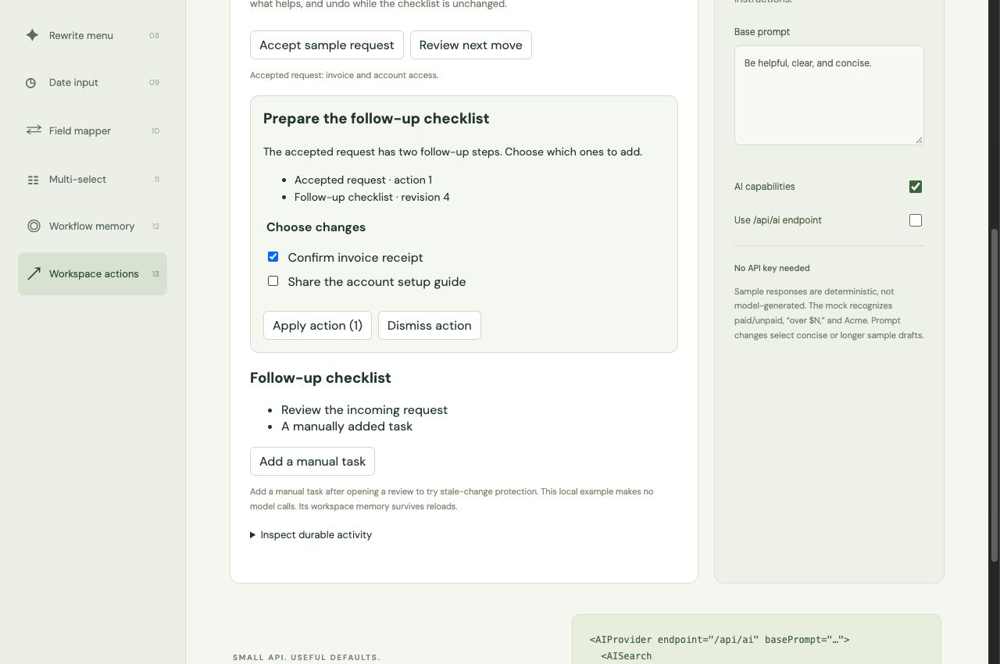
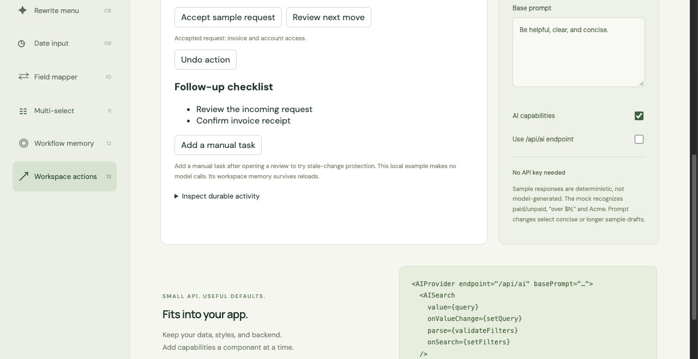

# Reviewable application actions

`useAIAction` accepts developer-defined proposals, validates current application state, executes a
reviewed selection, and records outcome history in the provider's existing memory. Pair it with
`AIActionReview`, or build your own UI. Proposal construction can be deterministic, model-assisted,
or supplied by a backend; the hook never generates or executes actions automatically.

```tsx
const action = useAIAction({
  type: 'tasks.add',
  source: 'meeting-followup',
  async validate(proposal, selectedIds) {
    await api.checkCurrentRevisions(proposal, selectedIds);
  },
  async execute(proposal, selectedIds, { mutationId }) {
    // The backend must check authorization + source/target revisions and deduplicate mutationId
    // in the SAME transaction that applies the selected changes. Return a JSON receipt.
    return api.applySelected({ proposal, selectedIds, mutationId });
  },
  async undo(receipt, { mutationId }) {
    // Check the current revision before compensating; don't restore over newer edits.
    await api.undo({ receipt, mutationId });
  },
});

// Call from your prediction/policy layer when there is a useful candidate.
action.review({
  id: 'accepted-event-23:target-revision-7',
  title: 'Add follow-up tasks',
  evidence: [{ label: 'Accepted meeting actions', reference: 'event 23', revision: 4 }],
  steps: [
    {
      id: 'task-1',
      label: 'Confirm the timeline',
      payload: { text: 'Confirm the timeline', revision: 7 },
    },
  ],
});

<AIActionReview
  proposal={action.proposal}
  onAccept={action.accept}
  onDismiss={action.dismiss}
  onUndo={action.undo}
  canUndo={action.canUndo}
  busy={['validating', 'executing', 'undoing'].includes(action.status)}
  retryPending={action.retryPending}
  error={action.error}
/>;
```

Proposals require a stable ID for the exact payload and source revisions, a title, and unique labeled
steps with JSON payloads. Evidence is app-provided provenance, not a verified citation or proof of
model reasoning. The hook clones/freezes proposal data so caller mutations cannot silently alter a
review. Selection is checked against approved step IDs and passed in proposal order. A proposal with an accepted, dismissed, or undone outcome already retained in the same scope is
not offered again; use a new ID when the evidence/payload changes. This suppression is bounded by
memory retention, so it does not replace backend idempotency. Review alone
never applies state or records an accepted action. `validate` runs before first execution; rejection
keeps the proposal available without executing or recording acceptance.

## Retries and boundaries

An active execution locks duplicate clicks, replacement proposals, and dismissal. If execution fails,
the outcome may be uncertain: the attempted selection is frozen, and retry uses the same mutation ID.
Revalidation is skipped on an uncertain retry because the original revision may already include this
exact write; the executor must reconcile/deduplicate the ID and enforce its own atomic checks. Undo
also reuses a stable mutation ID on retry. If your endpoint authoritatively rejects a command and
**guarantees no mutation was committed** (for example, an atomic revision conflict), throw
`AIActionRejectedError`. This releases the attempt so the user can dismiss or review a new proposal;
a definitively rejected undo also permits a fresh review. Never use this error for a timeout or lost
response. Those outcomes require reconciliation with the original mutation ID. A failure to record an already returned receipt retries only
recording, without executing the application mutation again.

Accepted, dismissed, and undone outcomes become `${type}.accepted`, `${type}.dismissed`, and
`${type}.undone` actions in the selected memory scope. Accepted events include the proposal ID,
selected IDs, mutation ID, and JSON receipt. Use the persistent-memory controller and `fromActions`
to retain/retrieve them. A successful hook call means the executor and in-memory event recording
finished; persistence is asynchronous, so `await persistence.flush()` is the explicit durability step.

Pending attempts and undo controls live in the mounted hook; they are not restored across reloads.
Your backend should persist/reconcile outstanding commands if that is required. History retention
is bounded; it is not a durable transaction ledger. Provider scope changes clear visible review/undo
controls; an already running executor may finish and records to its original memory boundary.
Unmounting does not cancel a possibly committed server mutation. Keep authoritative mutation receipts
and an application recovery UI for that case.

Library memory and application mutations are separate operations. For transactional domain history,
commit the mutation and its event together on your backend, then project approved context into library
memory. The library does not supply authorization, database transactions, multi-writer conflict
resolution, a hosted agent, or an autonomous planner. Review another proposal after a successful
execution replaces this hook's previous one-level undo control. When undo execution is uncertain,
reconcile it before replacing the review.

The **Workspace actions** playground demonstrates these primitives with a deterministic support
follow-up policy, a revisioned local checklist, and persistent sample memory. Its domain rules live
in the example, not in the framework. Real apps should implement authoritative checks and durable
receipts in their own backend. No Folio model or checklist API is imported by the library.

## Playground screenshots




